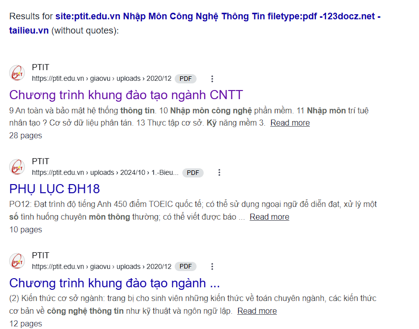

## Việc dùng toán tử FileType lại giúp tiết kiệm thời gian hơn so với việc gõ " tải sach ..." thông thường :

1. Gõ thông thường: (ví dụ PTIT: Nhập môn công nghệ thông tin)
    * Cách dùng: gõ từ khoá hoặc câu hỏi muốn tìm vào ô tìm kiếm.
    * Kết quả: Google sẽ quét toàn bộ Internet và trả về mọi dạng nội dung có liên quan (trang web tin tức, bài viết blog, diên đàn, vdeo, tài liệu, PDF, Word, v.v)
2. Gõ với file type (ví dụ PTIT: Nhập môn công nghệ thông tinfiletype:pdf)
    * Cách dùng: bạn kết hợp từ khoá với toán tử filetype:[định dạng_file](như pdf, doc,docx,xls, xlsx, ppt, pptx ...)
    * Kêt quả: Google chỉ lọc và trả về các kết quả là tệp tin có định dạng cụ thể mà bạn đã chỉ định.

### Cú pháp site:ptit.edu.vn "Nhập Môn Công Nghệ Thông Tin" filetype:pdf -123docz.net -tailieu.vn

_____________

_____________